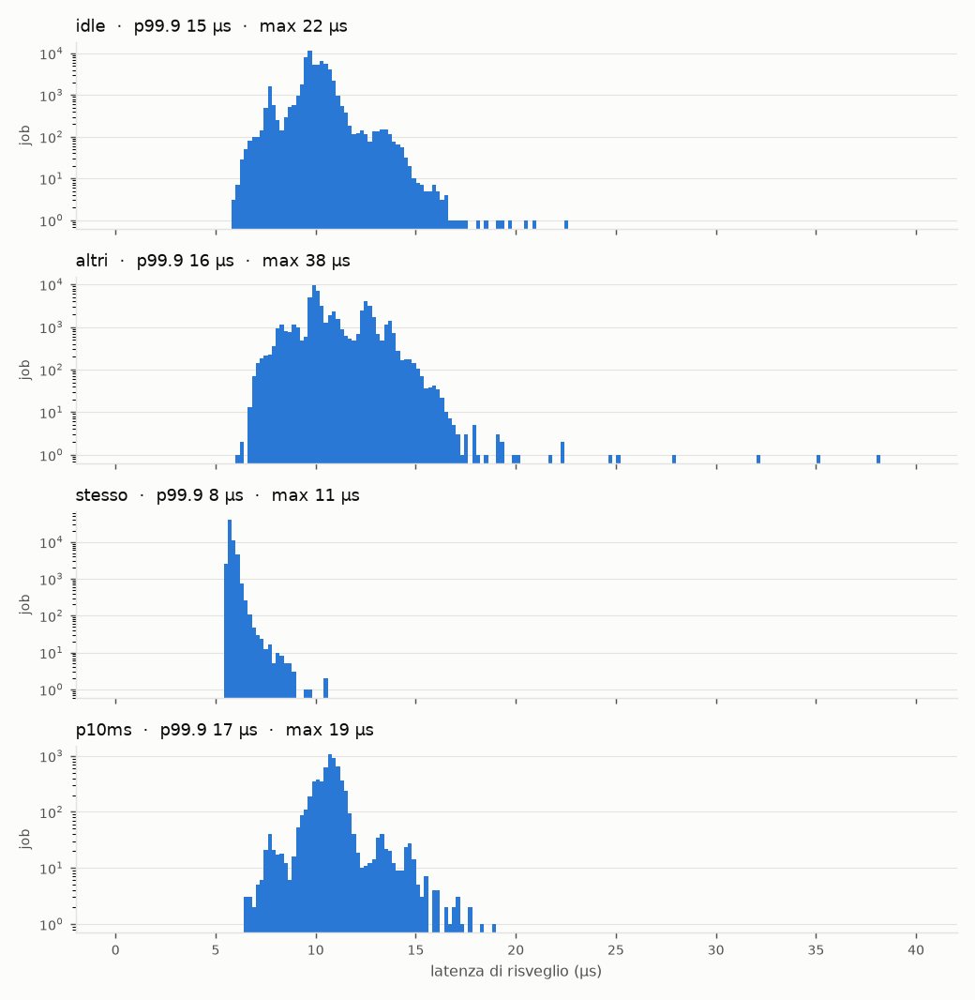

# Fase 0: toolchain e valori di riferimento real-time

Obiettivo: poter compilare per il robot e misurare quanto è "real-time" il suo Linux così com'è (kernel
3.4.39 `SMP PREEMPT`, non PREEMPT_RT), prima di scrivere qualunque task.

## Diario

### 1. Cross-compilatore (2026-10-01)
- **Scelta:** Bootlin `armv7-eabihf--musl--stable-2026.08-1`, cioè gcc 15.3.0, binutils 2.45.1, musl 1.2.6,
  header del kernel 5.10. Fonte: https://toolchains.bootlin.com/. Bootlin è l'azienda che sviluppa Buildroot;
  il README della toolchain spiega anche come ricostruirla da zero.
- **Verifica:** il file scaricato è stato controllato con il checksum SHA-256 pubblicato da Bootlin.
- **Perché musl e collegamento statico:** il robot usa già musl (`/lib/ld-musl-armhf.so.1`). Con un binario
  statico non dipendiamo dalla versione della libreria installata sul robot.
- **Dove sta:** in `toolchain/`, esclusa da git. Su un altro computer si installa con `tools/installa-toolchain.sh`.
- **Header 5.10 contro kernel 3.4.** La toolchain conosce system call che il kernel 3.4 non ha. Ho controllato
  nel sorgente di musl 1.2.6 come vengono gestite:
  - **`clock_nanosleep`** (`src/time/clock_nanosleep.c`): se i secondi stanno in 32 bit, ed è sempre così con
    `CLOCK_MONOTONIC`, usa direttamente la system call a 32 bit che il 3.4 ha. Nessun costo aggiuntivo.
  - **`clock_gettime`** (`src/time/clock_gettime.c`): il 3.4 su ARM non ha vDSO, cioè il meccanismo che
    permette di leggere l'orologio senza entrare nel kernel. musl prova prima `clock_gettime64`, che sul 3.4
    fallisce con `ENOSYS`, e poi ripiega su `clock_gettime`: **due system call per ogni lettura dell'orologio**.
    Il costo si vede nel tempo di esecuzione minimo di un job vuoto.
  - **Mutex con priority inheritance** (`src/thread/pthread_mutexattr_setprotocol.c`): supportati, perché
    usano `FUTEX_LOCK_PI`, presente nel kernel dal 2.6.18. `PTHREAD_PRIO_PROTECT` (priority ceiling) **non**
    è supportato da musl.
- **Flag:** `-mcpu=cortex-a7 -mfpu=neon-vfpv4 -mfloat-abi=hard -static`.

### 2. Libreria dei task (`rt/`)
- `rt_tempo.h`: tempo come `int64_t` in nanosecondi su `CLOCK_MONOTONIC`.
- `rt.h`/`rt.c`: task periodici `SCHED_FIFO` con priorità, affinità a un core, fase, deadline, stack
  esplicito e statistiche (latenza, tempo di esecuzione, tempo di risposta, deadline mancate).
  Spiegazione completa in `docs/GUIDA.md`.
- **Problema trovato e risolto.** Con `mlockall(MCL_FUTURE)` la creazione del thread falliva con `EAGAIN` sul
  PC. Lo stack di default di glibc è 8 MB e supera il limite di memoria bloccabile (`ulimit -l` = 8 MB).
  Soluzione: stack dichiarato per ogni task, default 256 KB, come in `xTaskCreate`.

### 3. Test
- `test/test_rt_tempo.c`: 23 controlli. Coprono le conversioni (anche con valori negativi), la monotonia
  dell'orologio e il fatto che `rt_dormi_fino_a` non ritorni mai prima dell'istante richiesto.
- `test/test_rt_task.c`: 28 controlli. Verificano:
  - configurazioni non valide;
  - numero di job eseguiti;
  - politica, priorità e core realmente applicati, osservati dall'interno del task;
  - assenza di deriva su 50 periodi;
  - conteggio delle deadline mancate;
  - limite del buffer dei campioni;
  - arresto di un task infinito;
  - mutex con priority inheritance.
- **Esito sul PC:** 51 controlli, 0 falliti.

### 4. Misura sul PC (solo come confronto)
`build/host/latenza -c 3 -d 5`, sul PC di sviluppo (x86, Linux 7.2.8 `PREEMPT_DYNAMIC`, 16 core):

| | min | media | max |
|---|---|---|---|
| latenza di risveglio | 9,2 µs | 59,7 µs | 870,4 µs |
| esecuzione job vuoto | 0,9 µs | 2,9 µs | 8,5 µs |

5000 job, 0 deadline mancate (D = T = 1 ms). Il massimo alto è tipico di un kernel desktop con risparmio
energetico: non è un dato che vale per il robot.

Seconda prova con `tools/analizza-latenza.py`, 3 s per misura, core 3:

| PC | p50 | p99 | p99.9 | max |
|---|---|---|---|---|
| sistema scarico | 40,4 µs | 65,2 µs | 254,6 µs | 375,8 µs |
| `carico -c 3` sullo stesso core (SCHED_OTHER) | 9,9 µs | 13,1 µs | 17,3 µs | 20,8 µs |

**Osservazione controintuitiva:** con un processo che occupa lo stesso core la latenza **scende**. Un core
inattivo entra in stati di risparmio energetico (C-state) da cui uscire costa tempo. Un core occupato è già
attivo, e `SCHED_FIFO` scavalca subito il processo `SCHED_OTHER`. Nei sistemi RT si disattivano proprio per
questo gli stati di idle profondi. Sul robot va verificato: il kernel ha il governor della frequenza fisso su
`performance` (`CONFIG_CPU_FREQ_DEFAULT_GOV_PERFORMANCE=y`), ma gli stati di idle sono un'altra cosa.

### 5. Configurazione del robot rilevata (2026-10-01)
Letta da `/sys` e `/proc` sul robot acceso, con AuxCtrl attivo:

| Voce | Valore | Cosa significa per noi |
|---|---|---|
| Kernel | `3.4.39 #993 SMP PREEMPT` | preemptible, non PREEMPT_RT |
| Core online | 4 (`0-3`) | |
| RAM | 512 MB, ~66 MB usati | spazio abbondante per buffer e campioni |
| Frequenza CPU | governor `performance`, fissa a 1,2 GHz | niente cambi di frequenza durante le misure |
| `autohotplug` Allwinner | `enable = 0`, nessun core mai spento | i core non spariscono sotto i task fissati |
| `sched_rt_runtime_us` | 950000 | i task RT possono usare al massimo il 95% di ogni secondo |

Sul robot gira un thread del kernel `auto_cpu_hotplug`. All'inizio sembrava la causa del problema descritto
sotto, ma la verifica in `/sys/kernel/autohotplug` lo ha escluso: è disattivato.

### 6. Problema incontrato: lo script delle misure "sembrava bloccato"
- **Sintomo:** dopo la prima misura non compariva più nessun risultato.
- **Due cause.**
  1. Durante una misura da 60 s lo script non stampa niente, e sembra fermo. Ora prima di ogni misura annuncia
     quanto dura.
  2. Un bug vero. Il comando mandato al robot era `cd /tmp/rtes && ./carico ... & sleep 1; ./latenza ...`.
     In shell `&` ha la precedenza più bassa di `&&`, quindi viene letto come `(cd /tmp/rtes && ./carico ...) &`:
     il `cd` avveniva dentro il processo in background. `./latenza` partiva dalla home, dove il programma non
     esiste, e falliva. Lo script non controllava l'esito e andava avanti.
- **Correzione:**
  - il `cd` è un comando separato (`cd /tmp/rtes || exit 1; ...`);
  - lo stato di uscita di `latenza` viene salvato prima del `wait` e restituito, così un errore ferma lo script.
- **Lezione:** gli script che lanciano processi in background devono controllare l'esito di ogni passo.

### 7. Misure sul robot
*Da fare: richiedono il robot acceso.* Si lanciano tutte con `tools/misure-fase0.sh` (circa 5 minuti), che
copia i programmi, esegue le misure 1, 2, 3 e 5, scarica i CSV in `build/robot/` e produce statistiche e
istogrammi (`build/robot/fase0.png`).

Sul robot non c'è `taskset`: il carico si genera con `bench/carico` (un thread al 100% per ogni core indicato).
Ogni misura dura 60 s, con il task di misura fissato al core 3 e priorità 80.

| # | Comandi (sul robot, in `/tmp/rtes`) | Cosa misura |
|---|---|---|
| 1 | `./latenza -c 3 -d 60 -o idle.csv` | latenza con il sistema scarico |
| 2 | `./carico -c 0,1,2 -d 70 &` poi `./latenza -c 3 -d 60 -o altri.csv` | se il carico sugli altri core disturba il core RT |
| 3 | `./carico -c 3 -d 70 &` poi `./latenza -c 3 -d 60 -o stesso.csv` | la preemption di `SCHED_FIFO` su un processo normale sullo stesso core |
| 4 | come 1, mentre il PC scarica un file grosso dal robot | l'effetto degli interrupt del Wi-Fi |
| 5 | `./latenza -c 3 -d 60 -p 10000 -o p10ms.csv` | dipendenza dal periodo (10 ms invece di 1 ms) |

Misura 4 (traffico Wi-Fi) non ancora fatta: richiede di generare traffico dal PC durante la misura.

### 8. Risultati sul robot (2026-10-01)
`tools/misure-fase0.sh`, 60 s per misura, task di misura sul core 3 con priorità 80 e job vuoto.
Log completo in `docs/misure/fase0-robot.txt`, istogrammi in `docs/misure/fase0-robot.png`.

| Misura | job | deadline mancate | latenza p50 | p99 | p99.9 | **max** |
|---|---|---|---|---|---|---|
| idle (sistema scarico) | 60000 | 0 | 9,9 µs | 13,4 µs | 14,9 µs | **22,4 µs** |
| altri (carico sui core 0–2) | 60000 | 0 | 10,2 µs | 14,8 µs | 16,4 µs | **38,1 µs** |
| stesso (carico sul core 3, SCHED_OTHER) | 60000 | 0 | 5,7 µs | 6,4 µs | 7,5 µs | **10,6 µs** |
| p10ms (periodo 10 ms) | 6000 | 0 | 10,8 µs | 14,7 µs | 17,1 µs | **18,9 µs** |

Tempo di esecuzione del job vuoto (in pratica il costo di una lettura dell'orologio, `clock_gettime`):
0,6–0,9 µs di media, massimo 2,1 µs.

**Cosa ci dicono:**
1. **Il Linux del robot, così com'è, è adatto ai nostri task.** Latenza peggiore osservata 38 µs, contro periodi
   previsti di 10–200 ms: meno dello 0,4% del periodo più breve. Nell'analisi di schedulabilità questo valore
   (con un margine) entra come ritardo massimo di rilascio (*release jitter*) di ogni task.
2. **Molto meglio del PC di sviluppo** (max 376 µs), nonostante sia un kernel del 2012 su una CPU lenta.
   Probabile motivo: niente stati di risparmio energetico profondi e frequenza fissa a 1,2 GHz.
3. **Un core occupato risponde più in fretta di uno inattivo** (10,6 µs contro 22,4 µs), come sul PC: svegliare un
   core dall'idle costa qualche microsecondo. E `SCHED_FIFO` scavalca davvero subito il processo normale:
   0 deadline mancate con un processo al 100% sullo stesso core.
4. **Il carico sugli altri core qualcosa disturba** (max 38 µs contro 22 µs). I core condividono cache L2 e bus
   di memoria, e `carico` fa scrivere tutti i thread sulla stessa variabile, quindi la linea di cache rimbalza
   continuamente tra i core. È il motivo per cui nei sistemi multi-core la partizione dei task sui core non
   basta da sola a garantire l'isolamento.
5. **Il periodo non cambia la latenza** (10 ms contro 1 ms: stessa distribuzione).

**Limiti di queste misure (da tenere presenti nella relazione):**
- 60 s sono pochi per il caso peggiore. La prassi (per esempio con `cyclictest`) è misurare per ore sotto carico:
  eventi rari (interrupt di rete, flush su NAND) possono dare picchi più alti. Va fatta una misura lunga
  (es. 1 ora) prima di fissare il valore usato nell'analisi.
- Manca la misura con traffico Wi-Fi (n. 4).
- AuxCtrl era attivo (heartbeat verso il GD32), RobotApp no: la situazione è simile a quella finale, in cui il
  nostro programma sostituirà entrambi.

### 9. Misure lunghe (notte 2026-10-01 → 2026-10-02)
Fatte la misura lunga e quella con traffico Wi-Fi: 5 misure da 1 ora (riposo, Wi-Fi, carico, caso peggiore,
stack originale), 0 deadline mancate, massimo 455,5 µs con carico e Wi-Fi saturo insieme.
Spiegazione e risultati in `docs/misure-lunghe.md`.
