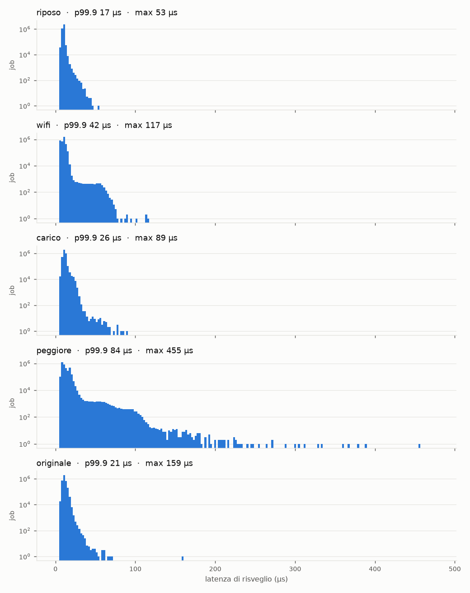

# Misure lunghe di latenza (notte 2026-10-01 → 2026-10-02)

Completano la fase 0 (`docs/fase0.md`, sezione 8). Le misure da 60 s non bastano per il caso peggiore: gli eventi
rari (interrupt di rete, flush su NAND, picchi di temperatura) si vedono solo su tempi lunghi. Qui ogni misura dura
**1 ora** (3.600.000 job), e c'è anche la misura con traffico Wi-Fi che mancava.

## Cosa si misura

Il task misurato è uno solo, `bench/latenza`:

| Parametro | Valore |
|---|---|
| Politica / priorità | `SCHED_FIFO`, 80 |
| Core | 3 (affinità fissa) |
| Periodo / deadline | 1 ms / 1 ms (D = T) |
| Lavoro per job | nessuno (`-e 0`): il job legge solo l'orologio |
| Durata | 3600 s → 3.600.000 job |

Per ogni job si registra la **latenza di risveglio**, cioè quanto il task parte in ritardo rispetto all'istante
teorico, e il **tempo di esecuzione**. La latenza massima è il ritardo minimo che subirà qualunque nostro task RT.
Nell'analisi di schedulabilità entra come *release jitter*.

## Come si generano i disturbi

- **Carico CPU, `bench/carico`.** Un thread per ciascuno dei core **0, 1 e 2**, fissato a quel core, gira in un
  ciclo stretto che incrementa un contatore `volatile` condiviso. I thread sono `SCHED_OTHER` (processi normali) e
  tengono i tre core al 100%. Il **core 3 non viene caricato**: si misura l'interferenza *indiretta* tra core, cioè
  cache L2 e bus di memoria condivisi (la linea di cache del contatore rimbalza tra i core), lock nel kernel e IRQ.
  La preemption sullo stesso core l'abbiamo già misurata nella fase 0 (misura "stesso"). Il programma serve perché
  sul robot non ci sono `taskset` né `stress`.
- **Wi-Fi saturo, dal PC.** 4 `ping -i 0.002 -s 8000` in parallelo verso il robot. Sul robot lavora solo il
  kernel (driver SDIO `sunxi-mmc`, frammentazione IP, risposta ICMP), nessun processo utente. L'IRQ del Wi-Fi va
  solo su CPU0. Abbiamo scelto il ping al posto di un trasferimento SSH perché la cifratura di SSH carica la CPU e
  mescolerebbe i due effetti (con SSH + `dd` si era visto un max di 443 µs).

## Le cinque misure

Lanciate in sequenza da `tools/notte.sh` (ognuna con `tools/misura-lunga.sh`), robot sulla base in carica,
dalle 00:14 alle 05:48.

| Misura | Software sul robot | Carico core 0–2 | Ping saturo |
|---|---|---|---|
| **originale** | stack del vendor completo (Monitor, RobotApp, AuxCtrl…), strace attivo nei primi ~8 min | no | no |
| **riposo** | solo AuxCtrl (serve l'heartbeat verso il GD32, altrimenti il robot si resetta) | no | no |
| **wifi** | solo AuxCtrl | no | sì |
| **carico** | solo AuxCtrl | sì | no |
| **peggiore** | solo AuxCtrl | sì | sì |

Tra "originale" e "riposo" ci sono 30 minuti di sola carica. Alla fine `notte.sh` riavvia lo stack originale, così
il robot continua a caricare. Il caso peggiore è stato messo per ultimo perché è il più pesante: se avesse fatto
cadere il robot, le altre misure sarebbero già state salve.

Durante ogni misura il PC controlla il robot ogni 30 s (uptime, temperatura, RAM libera, processi vivi) e scrive
tutto in `<nome>-monitor.txt`. Nessun allarme, nessun riavvio, nessun programma terminato in anticipo.

## Risultati

Latenza di risveglio in µs, 3.600.000 job per misura, **0 deadline mancate in tutte**.

| Misura | p50 | p99 | p99.9 | **max** | job > 50 µs | > 100 µs | > 200 µs | temperatura |
|---|---|---|---|---|---|---|---|---|
| riposo | 9,8 | 13,5 | 16,8 | **53,5** | 1 | 0 | 0 | 50–52 °C |
| wifi | 10,0 | 15,9 | 42,3 | **116,6** | 2240 | 4 | 0 | 58–66 °C |
| carico | 10,3 | 20,0 | 25,8 | **88,5** | 48 | 0 | 0 | 81–92 °C |
| peggiore | 10,8 | 28,0 | 83,6 | **455,5** | 16559 | 1118 | 37 | 81–97 °C |
| originale | 10,6 | 17,2 | 20,7 | **158,8** | 13 | 1 | 0 | 48–53 °C |

Tempo di esecuzione del job vuoto: media 0,8–1,3 µs, massimo 20 µs (nel caso peggiore).



### Cosa ci dicono

1. **Nessuna deadline mancata in 5 ore e 18 milioni di job**, anche nel caso peggiore. Con periodi previsti di
   10–200 ms il margine è enorme.
2. **Il caso peggiore viene dalla combinazione dei due disturbi.** Presi da soli, Wi-Fi e carico restano sotto
   i 120 µs. Insieme la coda si allunga molto: 1118 job oltre i 100 µs e un massimo di 455 µs, circa il 45% di un
   periodo da 1 ms. Ipotesi: gli IRQ e i softirq di rete su CPU0 competono con il thread di carico sullo stesso
   core, e il lavoro del kernel resta più a lungo dentro sezioni non preemptible o con lock condivisi. È
   esattamente il tipo di problema che PREEMPT_RT risolve trasformando gli IRQ in thread.
3. **Il Wi-Fi da solo sposta la coda, non il centro.** La p50 resta a 10 µs, ma compare una "spalla" tra 30 e
   70 µs (2240 job oltre i 50 µs). Coincide con le misure brevi della sera prima (`misure/wifi-breve.txt`).
4. **Temperatura alta sotto carico: fino a 97 °C.** Il massimo del caso peggiore (minuto 51,7) cade proprio
   quando il monitor registra il picco di 97 °C (05:40). Potrebbe essere una coincidenza oppure l'effetto della
   protezione termica (throttling). Da verificare prima della fase con i motori: se la frequenza scende, i tempi
   di esecuzione dei task si allungano.
5. **Lo stack originale non disturba molto.** p99.9 a 20,7 µs, simile al riposo. Il massimo di 158,8 µs cade al
   minuto 6,8 (circa 00:20:50), proprio quando strace ha fatto terminare AuxCtrl e Monitor lo ha rilanciato
   (`Log/cattura-stream/stream.log`, 00:21:05). Va quindi attribuito a strace, non allo stack del vendor.

### Valore da usare nell'analisi di schedulabilità

Come release jitter conviene usare **J = 500 µs** per ogni task: copre il massimo osservato (455 µs) nelle
condizioni peggiori che abbiamo saputo creare. Se nel progetto finale il Wi-Fi resta poco usato, il valore
realistico è sotto i 120 µs. Restano comunque due cautele:
- una misura, per quanto lunga, non dimostra un limite superiore: è un valore osservato, non garantito;
- mancano ancora i motori e la UART verso il GD32, che porteranno i loro interrupt.

## Misure brevi con Wi-Fi (sera del 2026-10-01)

Fatte prima della notte, 60 s ciascuna, solo AuxCtrl, 4 ping dal PC con `-i 0.002`:

| Misura | pacchetti | p99.9 | max |
|---|---|---|---|
| wifi-moderato | 1472 byte | 17,1 µs | 23,7 µs |
| wifi-saturo | 8000 byte | 48,6 µs | 66,5 µs |

Le dimensioni dei pacchetti vengono dagli appunti della sessione: i comandi esatti non sono stati salvati.
Dettagli in `misure/wifi-breve.txt` e `misure/wifi-breve.png`.

## Problemi incontrati

- **Riavvii con la batteria scarica.** Il primo tentativo di misura lunga (2026-10-01, 23:07) si è interrotto
  dopo ~30 s: il robot si è riavviato. Causa: batteria sotto la soglia di protezione
  (`EXCEPTION_BATTERY_PROTECTION_VOLTAGE` nel log di RobotApp), e la ricarica la avvia solo RobotApp. Per questo la
  notte inizia con lo stack originale sulla base, che intanto ricarica. Log del tentativo:
  `build/robot/notte-2026-10-02/prova-generale/lunga-monitor-23h09.log`.
- **strace fa terminare AuxCtrl.** Agganciare strace ad AuxCtrl lo fa terminare entro ~12 s (successo 3 volte di
  fila). Per la fase 1 conviene sniffare la UART in hardware, oppure usare strace per tempi brevi.
- **Prova generale.** Prima della notte `notte.sh` è stato provato con `DURATA=60` per verificare tutta la
  sequenza (`build/robot/notte-2026-10-02/prova-generale/`).

## Dove sono i file

| Dove | Cosa | In git |
|---|---|---|
| `docs/misure/notte-2026-10-02/` | per ogni misura: `<nome>.png` (istogramma), `<nome>-latenza.txt` (output di `latenza`, una riga ogni 30 s), `<nome>-monitor.txt` (sorveglianza dal PC); `notte.txt` (riepilogo della sequenza); `confronto.png` | sì |
| `docs/misure/wifi-breve.*` | misure brevi con ping | sì |
| `build/robot/notte-2026-10-02/` | gli stessi file più i CSV completi (~35 MB ciascuno, un campione per job) e la prova generale | no |
| `build/robot/fase0/`, `build/robot/wifi-breve/` | CSV delle misure da 60 s | no |

I CSV restano fuori da git per le dimensioni (~170 MB in tutto, ~50 MB compressi). Dai CSV si rifanno statistiche e
grafici con `tools/analizza-latenza.py`.

## Come ripeterle

```sh
tools/notte.sh                                   # sequenza completa, ~5,5 h (DURATA e ATTESA modificabili)
NOME=peggiore CARICO=1 PING=1 tools/misura-lunga.sh   # una misura sola
DURATA=60 tools/notte.sh                         # prova generale
```

Prerequisiti: robot sulla base con lo stack originale attivo (deve caricare) e raggiungibile via Wi-Fi.
I risultati finiscono in `build/robot/`: dopo averli controllati vanno spostati in una cartella con la data, come
qui.
